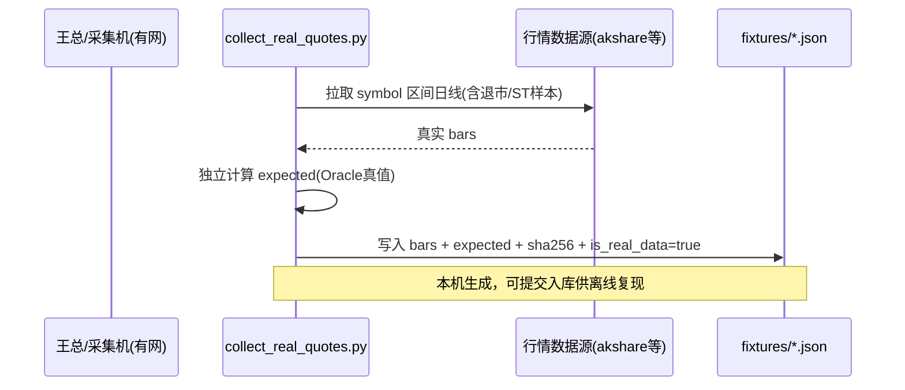
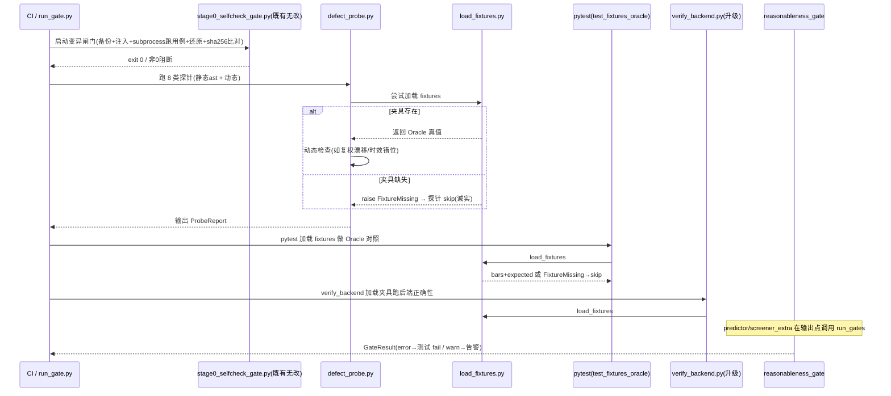

# 股票论坛可视化查看器 — 阶段1~3 落地设计方案

> 文档性质：**架构设计 / 规格说明（不含实现代码）**
> 作者：架构师 高见远
> 覆盖范围：用户要求的 5 项工作（CI 纳入自检闸 / 阶段1 defect_probe / 阶段2 离线真实行情夹具 / 阶段3 KNOWN_DEFECTS+合理性闸门+环境一致性 / git 提交+旧脚本职责边界）
> 约束基线：沿用阶段0 三文件，严守"红线"——绝不假数据冒充真实行情、沙箱无网诚实降级、不破坏生产源码、零源码污染。

---

## 1. 实现方案概览 + 框架选型

### 1.1 核心目标
在不改动生产源码稳定逻辑、不引入假数据的前提下，把"正确性保障体系"从阶段0的"纯合成桩 + 变异闸门"升级为覆盖**静态对抗检查（探针）+ 真实历史 Oracle 对照（夹具）+ 输出合理性闸门（运行时防护）+ 缺陷不二过（注册表）**的四层防御，并以 **CI + 本地门禁** 双通道强制门槛。

### 1.2 技术选型（默认，零新增重依赖）
| 维度 | 选型 | 理由 |
|------|------|------|
| 语言 | Python 3.10+（项目既有 `.venv`） | 与生产同栈，无需新解释器 |
| 标准库 | `os / sys / json / hashlib / subprocess / argparse / ast / dataclasses / pathlib / datetime / logging` | 探针静态分析用 `ast`；闸门/夹具/CI 包装全用标准库 |
| 测试 | `pytest`（已在 `.venv`，可用） | 不新增测试框架 |
| 数据格式 | JSON 文件（`fixtures/*.json`、`KNOWN_DEFECTS.json`、`stage0_mutations.json`） | 离线、人类可读、可 sha256 锁定 |
| CI | GitHub Actions（`.github/workflows/`） | 项目已有一个 workflow，沿用同机制 |
| **依赖增量** | **0 个运行时新增依赖** | 唯一外部库 `akshare`/`tushare` 仅作用于"王总本机采集脚本"，不在沙箱/CI 运行时强制安装 |

### 1.3 架构分层
```
┌──────────────────────────────────────────────────────────┐
│  Layer 0  采集层（王总本机·有网·一次性）                    │
│  fixtures/collect_real_quotes.py  →  fixtures/*.json       │
└──────────────────────────────────────────────────────────┘
                         │ 离线文件落地（sha256 内嵌）
┌──────────────────────────────────────────────────────────┐
│  Layer 1  夹具加载层（离线·沙箱/CI/本机通用）              │
│  fixtures/load_fixtures.py  →  Oracle 真值 + 行情片段       │
└──────────────────────────────────────────────────────────┘
        │                  │                    │
┌───────┴────┐   ┌─────────┴────────┐   ┌───────┴────────┐
│ 测试层      │   │ 探针层(defect_)  │   │ 闸门层(运行时)  │
│ test_*.py  │   │ probe.py 8类对抗 │   │ reasonableness │
│ Oracle对照  │   │ 静态+动态        │   │ _gate.py 挂接  │
└────────────┘   └──────────────────┘   └────────────────┘
        │                  │                    │
┌───────┴──────────────────┴────────────────────┴──────────┐
│  门禁层：stage0_selfcheck_gate.py（变异闸门·既有无改）      │
│  + .github/workflows/selfcheck-gate.yml（CI）              │
│  + scripts/run_gate.py（本地等价门禁）                      │
└──────────────────────────────────────────────────────────┘
        │
┌───────┴──────────────────────────────────────────────────┐
│  记录层：KNOWN_DEFECTS.json（缺陷不二过）+ 报告 reports/    │
└──────────────────────────────────────────────────────────┘
```

---

## 2. 文件清单（相对项目根 `stock-forum-scraper/`）

### 2.1 新增文件
| 路径 | 作用 | 对应工作项 |
|------|------|-----------|
| `fixtures/collect_real_quotes.py` | 王总本机有网时运行，从数据源抓取真实行情并落盘 + 独立计算 Oracle 真值 | W3 |
| `fixtures/load_fixtures.py` | 离线加载框架：读 `fixtures/*.json`，校验 sha256，缺则 `raise FixtureMissing`（测试据此 skip） | W3 |
| `fixtures/_schema_template.json` | 夹具 JSON Schema 模板（字段/类型/约束说明，非真实数据） | W3 |
| `fixtures/README.md` | 采集步骤、运行命令、标的/区间默认建议、涉密入库说明 | W3 |
| `fixtures/.gitkeep` | 保留空目录纳入 git（真实 `*.json` 由王总生成后入库） | W3/W5 |
| `defect_probe.py` | 8 类领域对抗探针（静态 `ast` + 动态跑夹具/合成桩），输出 `ProbeReport` | W2 |
| `test_defect_probe.py` | defect_probe 自测（含对合成桩的静态断言） | W2 |
| `viewer/reasonableness_gate.py` | **新增防护函数模块**：核心指标合理性闸门（total_return/sharpe/drawdown/单日收益），自身有单测 | W4 |
| `test_reasonableness_gate.py` | 闸门单测（含越界触发、边界不触发、负数 drawdown 等） | W4 |
| `KNOWN_DEFECTS.json` | 历史缺陷注册表（缺陷不二过），含回归保护指向 | W4 |
| `test_fixtures_oracle.py` | 阶段2 升级的正确性断言：以真实夹具做 Oracle 对照（缺夹具则 skip，绝不假 PASS） | W3 |
| `.github/workflows/selfcheck-gate.yml` | CI：push/PR 触发，跑 `stage0_selfcheck_gate.py`，非零即阻断 | W1 |
| `scripts/run_gate.py` | 本地门禁：等价 CI，包装 `stage0_selfcheck_gate.py`（并可选串联 defect_probe + 闸门自检） | W1 |
| `.gitignore` | 排除 `__pycache__/ node_modules/ *.db *.log cookies.txt 个人凭证 缓存json` 等，仅收源码+新增测试+夹具+文档 | W5 |
| `reports/.gitkeep` | 探针/闸门报告输出目录占位 | W2/W4 |

### 2.2 修改文件（最小侵入，不改稳定逻辑）
| 路径 | 修改内容 | 对应工作项 |
|------|----------|-----------|
| `verify_backend.py` | 升级为优先加载 `fixtures/` 真实夹具做 Oracle 对照；缺夹具诚实报错（沿用其"真实数据/诚实报错"语义，不改成假 PASS） | W3 |
| `viewer/predictor.py` | 在核心输出点（如 `_window_ret`/预测信号产出后）**最小侵入调用** `reasonableness_gate` 的 `run_gates()`，仅告警/记录，不改动计算逻辑 | W4 |
| `viewer/screener_extra.py` | 在 `backtest` 返回 metrics 处**最小侵入调用** `reasonableness_gate.run_gates()`（含 `_trade_cost`/退市强平分支） | W4 |

> **阶段0 三文件（`stage0_selfcheck_gate.py` / `stage0_mutations.json` / `test_stage0_correctness.py`）不修改**，仅通过 CI workflow 与本地脚本"调用集成"。

---

## 3. 数据结构与接口

### 3.1 defect_probe 输出结构（`ProbeReport`）
```python
# defect_probe.py
@dataclass
class ProbeFinding:
    probe_id: str          # "P1".."P8"
    category: str          # look_ahead_bias / survivorship / adj_drift / overfit / zero_cost / t1_limit_liq / data_gap / time_misalign
    target: str            # "viewer/predictor.py::_window_ret" 或 "viewer/screener_extra.py::backtest"
    method: str            # "static" | "dynamic"
    severity: str          # "info" | "warn" | "error"
    status: str            # "pass" | "warn" | "fail" | "skip"
    evidence: str          # 行号/代码片段/观测指标
    recommendation: str

@dataclass
class ProbeReport:
    generated_at: str                  # ISO8601 UTC
    code_sha256: str                   # 被测源码快照哈希（可复现）
    python_version: str
    environment: str                   # "sandbox_offline" | "collection_host"
    fixtures_loaded: bool
    findings: List[ProbeFinding]
    summary: dict                      # {pass,warn,fail,skip, overall:"pass_with_warnings"|"fail"}
    report_path: str                   # reports/defect_probe_<ts>.md|json
```

### 3.2 夹具 JSON Schema（`fixtures/*.json`）
```json
{
  "metadata": {
    "source": "akshare|tushare|eastmoney",
    "collected_at": "2026-09-22T10:00:00Z",
    "symbol": "600000.SH",
    "instrument_type": "stock|delisted|index",
    "adj": "qfq|hfq|none",
    "fields": ["date","open","high","low","close","vol","amount"],
    "trade_days": 242,
    "is_real_data": true,
    "sha256": "<本文件内容的 sha256，加载时校验防篡改>"
  },
  "bars": [
    {"date":"2023-01-03","open":10.5,"high":10.8,"low":10.4,"close":10.7,"vol":123456,"amount":1320000}
  ],
  "expected": {
    "total_return": 0.1234,
    "ann_return": 0.18,
    "sharpe": 0.85,
    "max_drawdown": -0.07,
    "daily_returns": [0.01, -0.02, "..."]
  }
}
```
- `expected` = **Oracle 真值**：由 `collect_real_quotes.py` 用**独立于被测系统**的受信方法（如 `pandas`/`numpy` 单独核算）计算并冻结；`test_fixtures_oracle.py` 断言 `|SUT - expected| < EPS`。
- `is_real_data: true` 与文件头注释共同构成"真值凭据"；任何 `is_real_data` 为 false 或缺失的 JSON 一律被 `load_fixtures` 拒绝（绝不混入合成数据冒充真值）。

### 3.3 KNOWN_DEFECTS 条目结构
```json
{
  "defects": [
    {
      "id": "DEF-2026-001",
      "title": "predictor 前视偏差：信号引用未来 close",
      "category": "look_ahead_bias",
      "module": "viewer/predictor.py",
      "function": "_window_ret",
      "introduced_at": "2026-09-22T00:00:00Z",
      "discovered_by": "defect_probe|P1|manual",
      "root_cause": "...",
      "fix_commit": "本地提交哈希 或 pending",
      "status": "fixed|open|mitigated",
      "guard": "reasonableness_gate.check_total_return / defect_probe P1",
      "regression_guard": "fixtures/oracle_600000.json#expected.total_return",
      "notes": "缺陷不二过：修复后由回归保护锁定，再次触发即 fail"
    }
  ]
}
```

### 3.4 合理性闸门 触发/报告接口（`viewer/reasonableness_gate.py`）
```python
@dataclass
class GateResult:
    name: str            # "total_return" | "sharpe" | "max_drawdown" | "daily_return"
    ok: bool
    level: str           # "ok" | "warn" | "error"
    observed: float
    bounds: tuple        # (lower, upper) 经验合理区间
    message: str

def check_total_return(value: float, ctx: dict) -> GateResult
def check_sharpe(value: float, ctx: dict) -> GateResult
def check_drawdown(value: float, ctx: dict) -> GateResult
def check_daily_return(value: float, ctx: dict) -> GateResult
def run_gates(metrics: dict, ctx: dict) -> List[GateResult]
```
- **触发点**：`predictor.py` / `screener_extra.py` 核心输出处最小侵入调用 `run_gates(metrics, ctx)`。
- **报告**：返回 `GateResult` 列表；`level=="error"` 时记日志 + 在测试模式（`ctx["test_mode"]=True`）下抛 `GateViolation`；生产模式仅告警/写 `reports/gate_warnings.json`，**绝不静默吞掉也不阻断业务**（闸门只防护不替代计算）。

---

## 4. 程序调用流程（时序 / 数据流）

### 4.1 采集阶段（王总·本机·有网·一次性）


### 4.2 校验阶段（沙箱/CI/本机·离线）


---

## 5. 任务列表（有序 · 含依赖 · 按实现顺序排列 · P0/P1）

> 每条标注：产出文件（→）+ 对应工作项（W1..W5）

- **T1（P0）工程初始化与 git 卫生** → `.gitignore`、`docs/` 目录建立。覆盖 **W5**。依赖：无。
- **T2（P0）离线夹具采集与加载框架** → `fixtures/collect_real_quotes.py`、`fixtures/load_fixtures.py`、`fixtures/_schema_template.json`、`fixtures/README.md`、`fixtures/.gitkeep`。覆盖 **W3**。依赖：T1（目录纳入 git）。
- **T3（P0）合理性闸门模块 + 最小侵入挂接** → `viewer/reasonableness_gate.py`、`test_reasonableness_gate.py`，并最小侵入修改 `viewer/predictor.py`、`viewer/screener_extra.py` 挂 `run_gates()`。覆盖 **W4**。依赖：无（新增独立模块；挂接前需通读两个生产文件确认输出点）。
- **T4（P0）阶段1 defect_probe 8 探针** → `defect_probe.py`、`test_defect_probe.py`、`reports/.gitkeep` 与报告模板。覆盖 **W2**。依赖：T3（部分探针复用闸门思路）、T2（动态探针用夹具/合成桩）。
- **T5（P0）CI 自检闸 workflow + 本地门禁** → `.github/workflows/selfcheck-gate.yml`、`scripts/run_gate.py`。覆盖 **W1**。依赖：T1（workflow 路径）。
- **T6（P1）verify_backend.py 升级加载夹具** → 修改 `verify_backend.py`，优先 Oracle 对照、缺则诚实报错。覆盖 **W3**。依赖：T2。
- **T7（P1）KNOWN_DEFECTS 注册表** → `KNOWN_DEFECTS.json` + 文档说明回归保护指向（关联 T3 闸门、T4 探针、T6 测试）。覆盖 **W4**。依赖：T3、T4。
- **T8（P1）Oracle 正确性测试** → `test_fixtures_oracle.py`，接入 CI/本地门禁（缺夹具 skip，绝不假 PASS）。覆盖 **W3**。依赖：T2、T6。
- **T9（P0）本地提交 + 旧脚本职责边界说明** → `git init` + `git add` 相关文件 + `git commit`（**仅本地，不推远端**）；在本设计文档 §8 固化 `verify_*.cjs` 职责边界说明。覆盖 **W5**。依赖：T1~T8 全部完成。

实现顺序：**T1 → (T2, T3, T5) 可并行 → T4（需 T2/T3）→ T6（需 T2）→ T7（需 T3/T4）→ T8（需 T2/T6）→ T9（收口）**。

---

## 6. 依赖包列表（零新增运行时依赖）

```
# 运行时 / 测试 —— 全部已在项目 .venv，无新增
- python==3.10+            # 项目既有解释器
- pytest@(已装)            # 测试运行器，已可用
- 标准库: os, sys, json, hashlib, subprocess, argparse, ast,
          dataclasses, pathlib, datetime, logging   # 无需安装

# 仅作用于"王总本机采集脚本"（不在沙箱/CI 运行时强制安装）
- akshare OR tushare       # 二选一，采集机 pip install，默认 akshare（免 token）
```

> 不引入 pandas/numpy 作为**项目依赖**（沙箱无网且避免重依赖）；Oracle 真值在采集机独立计算后冻结进 `expected`，消费端只做加减比较，无需重库。

---

## 7. 与阶段0 三文件的集成点

| 阶段0 文件 | 集成方式（不改动稳定逻辑） |
|-----------|---------------------------|
| `stage0_selfcheck_gate.py` | **CI 调用**：`selfcheck-gate.yml` 在 push/PR 步骤执行 `python stage0_selfcheck_gate.py`，`exit != 0` 即 `fail()` 阻断合并。**本地调用**：`scripts/run_gate.py` 直接 subprocess 该脚本，等价于 CI。其"备份+sha256→注入→跑用例→还原+sha256 比对"机制原样复用，零源码污染。 |
| `stage0_mutations.json` | `defect_probe.py` **复用其"注入故障必须被捕获"的哲学**作为 Oracle 思路：探针 P1~P8 的每条"应检出"规则，可对照 mutations 的 5 种子+1 legacy 确保方向一致；设计上新增探针不重复 mutations 已覆盖的注入点，而是补足"静态可判定"的偏差类（前视/幸存者/复权漂移等），形成互补而非重叠。 |
| `test_stage0_correctness.py` | 其 5 个**纯合成桩**正确性断言保持不变（合法合成桩，文件头已标注"合成测试桩，非产品行情"）。阶段2 **新增** `test_fixtures_oracle.py` 在其旁并列，把"纯公式验证"升级为"真实历史片段 Oracle 对照"，二者职责分离、互不替代。 |

---

## 8. 旧 `verify_*.cjs` 职责边界说明（写入设计，不替换）

- **定位差异**：旧 `verify_*.cjs`（67+）绝大多数是 **UI 存在性 / 结构 / 不报错护栏**（如某按钮、某面板、某 DOM 节点是否渲染、进程是否崩溃），属于**前端冒烟层**；而阶段0~3 新增体系（`stage0_selfcheck_gate` / `defect_probe` / `fixtures Oracle` / `reasonableness_gate`）属于**后端领域正确性层**。
- **为何不替换**：UI 存在性脚本与数值正确性脚本目标不同、技术栈不同（Node 前端 vs Python 后端），强行合并会污染前端护栏、引入跨语言耦合，且违反"红线3——不破坏既有稳定逻辑"。二者应**并存互补**：前端护栏保"界面不崩"，后端体系保"算得对"。
- **唯一例外**：`verify_backend.py`（Python，且已要求真实数据/诚实报错）是旧脚本中**唯一带正确性语义**者——因此它被纳入阶段2 升级（T6 加载夹具），而非被新体系取代。其余 `verify_*.cjs` 保持不动。
- **降级契约**：所有新增/升级的正确性检查在沙箱无网、夹具缺失时一律 **skip 或诚实报错**，绝不以"UI 不报错"冒充"数据正确"，绝不允许假 PASS。

---

## 9. 待明确事项（已给合理默认，不把决策丢回用户）

| # | 事项 | 合理默认（设计已采用） |
|---|------|------------------------|
| Q1 | 真实行情夹具采集 | 默认提供 `collect_real_quotes.py`，王总在**本机有网**执行 `python fixtures/collect_real_quotes.py --symbol 600000.SH --start 2023-01-01 --end 2023-12-31` 生成；沙箱只跑"加载离线夹具"，缺失即 skip。 |
| Q2 | CI 是否现在生效 | 默认先 `git init` + **本地提交、不推远端**；workflow 文件就位，一旦 `git remote add` + push 到 GitHub，Actions 自动生效。本地可用 `scripts/run_gate.py` 等价预检。 |
| Q3 | 采集数据源 | 默认 **akshare**（免费、免 token）；采集脚本以 `source` 参数抽象，王总可切 tushare/eastmoney。 |
| Q4 | 夹具标的/区间 | 默认覆盖 **2~3 只代表性标的**（含 1 只曾退市/ST 以触发幸存者偏差/强平探针）+ 约 1 年日线；王总可扩展。 |
| Q5 | 环境一致性/可复现 | 默认 `fixtures/*.json` 内嵌 `sha256`，`load_fixtures` 加载时校验；`ProbeReport` 记录 `code_sha256` 与 `python_version`；可选 `pip freeze > requirements.lock.txt` 仅作记录不强制安装。 |
| Q6 | 合理性阈值 | 默认经验区间：`total_return` 年化 `[-0.95, 5.0]`、`sharpe [-3, 5]`、`max_drawdown [-1.0, 0]`、单日收益 `[-0.11, 0.11]`（含涨跌停）；阈值集中在 `reasonableness_gate` 常量区，王总可调。 |
| Q7 | 真实数据是否入库 | 默认**提交 `fixtures/*.json` 入库**（沙箱无网必须离线可用）；若数据涉密，改为仅提交 `fixtures/.gitkeep` + 采集说明、真实 json 本地保留（`.gitignore` 排除 `fixtures/*.json` 即可），设计已预留此开关。 |
| Q8 | 退市/ST 样本强平 | `screener_extra.py` 392-408 行退市强平逻辑由合理性闸门 + 探针 P6（T+1/涨跌停/流动性）覆盖验证，默认不改动其计算，仅挂接告警。 |

---

## 10. 风险与缓解

| 风险 | 等级 | 缓解 |
|------|------|------|
| **最大风险**：真实行情夹具依赖王总本机有网手动执行一次，沙箱无网时 Oracle 正确性断言只能 skip，沙箱内无法证明"真值" | 高 | 设计上把"采集"与"校验"彻底解耦；缺夹具时测试**诚实 skip + 报告标注**，绝不假 PASS；本地门禁/CI 在王总推送后于有网环境补全真值验证。 |
| 最小侵入挂闸门选错输出点污染生产 | 中 | "新增防护函数 + 最小侵入调用 + 闸门自测"三保险；T3 先写 `reasonableness_gate` 单测，再只读挂接，不改计算。 |
| 采集脚本数据源接口变动 | 低 | `source` 抽象 + README 注明版本；Oracle 真值冻结，消费端不依赖源。 |
| 旧 `verify_*.cjs` 与新增体系冲突 | 低 | 职责边界固化（§8），并存互补，不替换。 |

---

*（本文档为设计规格，不含任何实现代码；落地时按 §5 任务顺序由工程师执行。）*
