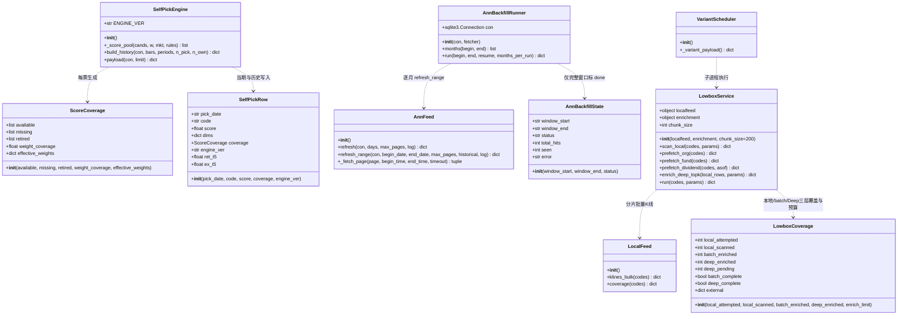
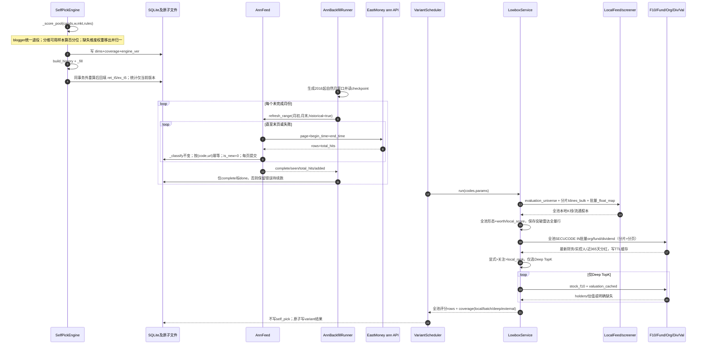
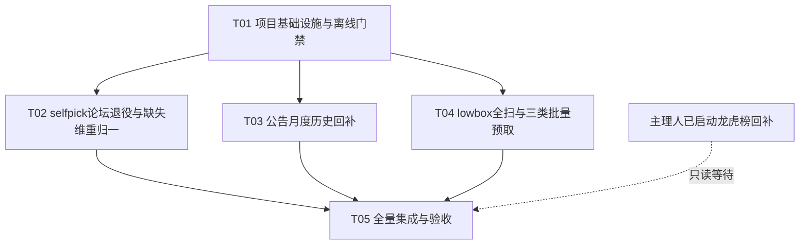

# 评分与数据覆盖增量架构设计

> 范围：`selfpick` 可用维度重归一化、公告 2016 年起历史回补、`lowbox` 扩大覆盖。仅设计，不在本阶段修改业务代码。龙虎榜 2010–2015 已由主理人运行 `tools/backfill_lhb.py`，本方案不另起任务、不并发写同一批数据。

## Part A：系统设计

### 1. 实现方案

#### 技术难点与选择

| 难点 | 方案 | 理由 |
|---|---|---|
| by_state 绕过论坛退役，blogger 权重复活；缺失舆情又被填 50 | `_env_weight` 所有来源/fallback 最终统一 `R._drop_blogger`；每维先判定可用性，缺失维移出并在剩余正权重维归一 | blogger 永久为 0；同时消除“50 分托底”和“缺失样本污染他人分位” |
| 新旧算法成绩混算 | `ENGINE_VER` 升级并逐行落 `engine_ver`；统计只算当前版本；历史期次统一回算 | 防止 v1.0/v1.1 混合制造虚假改善或恶化 |
| 公告长历史分页截断、失败后续跑 | 抽出任一日期闭区间抓取；按月分窗；记录每月状态和 `total_hits`；失败/截断不标完成 | 可断点续跑、可发现漏页，不靠一次长任务侥幸成功 |
| lowbox 外部成本随股票数线性增长 | 全干净宇宙本地初扫；org/fund/dividend 全池 `SECUCODE IN` 批量预取；仅 stock_f10/valuation 做 Deep TopK | 三类已实测批量接口消除主要逐只成本，不把盲调 80 上限当成方案 |
| 重计算拖住查看器 | 沿用 `variant_payload` 子进程和参数签名落盘；请求线程只读 | 符合现有架构，不引入新 Web/任务框架 |

不新增第三方框架。继续使用 Python、SQLite、标准库并发/CLI、现有 JSON 缓存和原生 JS。新增 `viewer/lowbox.py` 承载扫描服务，避免继续膨胀 `viewer/server.py`；`selfpick.py` 保持函数式，不做无谓类化。

#### selfpick 评分契约

维度：`blogger / strategy / senti / engine`，其中 `blogger` 已永久退役。

- **P0 统一出口**：`_env_weight` 无论取全局、by_state 或任何默认 fallback，返回前都必须执行 `R._drop_blogger(w)`，再将 `strategy/senti/engine` 非负权重归一；`w['blogger']=0`。by_state 不得绕过，fallback 不得恢复 blogger。
- coverage 将 blogger 列入 `retired`，不列入 `missing`，也不计入覆盖率分母。博主字段可保留作历史解释，但不得影响 score/rank/tier。
- 可用性：`senti` 必须 `senti_n>0` 且 `senti_net IS NOT NULL`；其余未退役维度原值为 `NULL` 才算缺失，数值 0、空 `engine_cross` 是“已观测为零”，不是缺失。
- 各维百分位数组只包含该维可用候选；全池同值仍为 50；候选该维缺失则 `dims[d]=None`，不再填 50。
- 令 `W=sum(max(0,w[d]) for d in strategy/senti/engine)`，`A` 为该票可用且 `w[d]>0` 的维度：
  - `weight_coverage = sum(w[d] for d in A)/W`；
  - `effective_w[d] = w[d]/sum(w[x] for x in A)`；
  - `base = sum(effective_w[d] * pct[d] for d in A)`。
- `W<=0` 时本次构建明确报权重配置错误；单票 `A` 为空时不产出虚假 0 分，该候选不进入榜单并计入 `unscorable`。规则加成仍后加、最终仍截到 0–100；coverage 只披露，不额外惩罚分数。
- `dims_json` 保持原结构以兼容前端；新增 `coverage_json`，证据文案使用 effective weights，不再展示原始权重造成的假算式。

单票 `coverage`：

```json
{
  "retired": ["blogger"],
  "available": ["strategy", "engine"],
  "missing": ["senti"],
  "weight_coverage": 0.344,
  "effective_weights": {"strategy": 0.62, "engine": 0.38}
}
```

`self_pick` 幂等新增列：`coverage_json TEXT`、`engine_ver TEXT`。旧行允许为空；新行写当前版本。`payload()` 每行新增 `coverage`，统计与 `_tier_stats()` 仅聚合同一 `ENGINE_VER`，并披露统计版本。`build_history()` 返回实际 `periods_written`、`unscorable`、`coverage_avg`，不是只返回计划期数。

#### ann_feed 历史回补契约

```python
_fetch_page(page, begin_time="", end_time="", timeout=15) -> (rows, total_hits)
refresh(con, days=3, max_pages=120, log=None) -> dict  # 原日更语义不变
refresh_range(con, begin_date, end_date, max_pages=1000,
              historical=True, log=None) -> dict
```

- URL 显式带 `begin_time/end_time`，日期为闭区间；结果仍按 `notice_date` 二次过滤，`nd<begin` 才可提前停页。
- 日更 `refresh()` 仅计算起止日后委托 `refresh_range(..., historical=False)`；分类仍唯一复用 `watchdesk._classify`，仍只存 `cat!='其他事务'`。
- 历史行 `is_new=0`，避免数年的历史公告涌入未读；`first_seen_at` 是实际采集时间，`disclose_at=notice_date+' 15:00:00'` 不变。
- 幂等键沿用 `(code,url)`；`url` 为空时用 `(code,notice_date,title)` 兜底。每页提交，失败重跑由去重兜住。
- 返回 `{ok,complete,begin,end,total_hits,pages,seen,kept,added,duplicates,oldest,newest,err,secs}`；`seen` 是实际读取条数，不再用 `pages*100` 冒充。`total_hits` 要求页数未拿全或中途失败时 `complete=false/ok=false`。

新增 `ann_backfill_state(window_start PK,window_end,status,pages,seen,kept,added,total_hits,attempts,error,updated_at)`。`tools/backfill_ann.py` 默认从 2016-01-01 起逐自然月串行执行；仅 `complete=true` 标 `done`，否则保留 `error/running` 供下轮重试。支持 `--begin/--end/--resume/--months-per-run/--max-pages/--dry-run`。不在 Web 请求线程运行，不与日更并行开多个回补进程。

#### lowbox 本地全扫 + 全池批量 + Deep TopK 契约

```python
api_screener_lowbox(codes="", limit=30, box_window=750, low_pct=30.0,
                    quality="off", w_shape=40.0, w_fund=35.0, w_worth=25.0,
                    scope="market", enrich_limit=120) -> dict

prefetch_org(codes) -> {code: org}
prefetch_fund(codes) -> {code: fund}
prefetch_dividend(codes, asof) -> {code: {ttm_div, last_ex}}
```

1. **本地全扫**：默认 `scope=market`，从 `evaluation_universe()` 出发；`watch` 保留旧语义。以约 200 只分片 `klines_bulk`，缺 K 线记失败、不逐只补网；`_float_map(chunk)` 批量准备流通股本。全池计算形态+worth/local_score，全部本地行供突破雷达复用。
2. **三类全池批量预取**：仅对缓存缺失/过期代码，按 50–100 只分片使用已实测的 `SECUCODE IN` 查询 `RPT_F10_BASIC_ORGINFO / RPT_F10_FINANCE_MAINFINADATA / RPT_SHAREBONUS_DET`，并处理分页。结果写现有 `lowbox_fund_cache.json` TTL。
   - org：按 `SECUCODE` 拆回 `{code:org}`；
   - fund：分页取全后每代码按 `max(REPORT_DATE)` 选最新，不依赖返回顺序；
   - dividend：仅 `ASSIGN_PROGRESS='实施分配'` 且除权日在近 365 天，`PRETAX_BONUS_RMB/10` 累加，`last_ex` 取最新。
3. **仅两类 Deep TopK**：按“显式代码 > 关注池 > local_score”选最多 `enrich_limit` 只，逐只补 `stock_f10`（holders/state_tag）与 `valuation_cached`。org 不再重复逐只取；全池不再承受五类函数逐只调用。
4. 全池行均可依据本地+batch 数据计算可用维度分；Deep 行再补估值和股东标签。每行标 `enrichment_level='batch'|'deep'` 与缺失 coverage，缺估值时基本面仍按 ROE/负债率可用项归一，不编造 0 分。quality 过滤继续遵循“数据缺失不误杀”。
5. 外部调用按实际批量请求、分页、Deep 函数与 HTTP 分别计数；不能用固定 `5*N` 估算新方案。全市场缺 K 线不走网络兜底，批量接口失败只标该批缺失并披露，不静默截断股票池。

响应保持原字段并新增：

```json
{
  "universe_size": 5000,
  "scanned": 4950,
  "rows": ["全池评分排序后的前limit行，不限Deep"],
  "pool_candidates": 5000,
  "pool_capped": false,
  "pool_max": 0,
  "coverage": {
    "scope": "market",
    "local_attempted": 5000,
    "local_scanned": 4950,
    "local_failed": 50,
    "batch_enriched": 4900,
    "deep_enriched": 120,
    "deep_pending": 4780,
    "enrich_limit": 120,
    "local_coverage": 0.99,
    "batch_coverage": 0.99,
    "deep_coverage": 0.024,
    "batch_complete": false,
    "deep_complete": false,
    "rejected_codes": [],
    "external": {"batch_requests": 0, "deep_function_calls": 0, "http_calls": 0, "cache_hits": 0}
  }
}
```

UI 分列披露本地、batch、Deep 覆盖；`deep_complete=false` 是设计内边界，不代表本地/batch 扫描失败，也不得把 Deep TopK 写成全市场 Deep 精算。

### 2. 文件清单

| 文件 | 动作 | 改动点 |
|---|---|---|
| `viewer/selfpick.py` | 修改 | 可用性、分位样本、动态权重、coverage、版本列、历史回算与统计隔离 |
| `tools/rebuild_selfpick_history.py` | 新增 | 备份后回算、前后 settled 收益对照、coverage 验证报告 |
| `viewer/ann_feed.py` | 修改 | 日期参数、共用 range 抓取、完整页数判定、回补状态表 |
| `tools/backfill_ann.py` | 新增 | 2016 年起月度串行回补、断点续跑、月度覆盖报告 |
| `viewer/lowbox.py` | 新增 | 分片本地全扫、org/fund/dividend批量预取、Deep TopK、预算与覆盖载荷 |
| `viewer/server.py` | 修改 | lowbox 委托服务；解析 `scope/enrich_limit`；保留 variant 入口 |
| `viewer/localfeed.py` | 修改（如需） | 仅补分片/计数辅助，不改 K 线口径、不新增逐只查询 |
| `viewer/static/app.js` | 修改 | selfpick retired/coverage 标签；lowbox 本地/batch/Deep三层覆盖披露 |
| `tools/sched_job.py` | 修改 | 保持 lowbox variant 子进程入口；回补脚本不挂请求线程 |
| `tests/test_selfpick_coverage.py` | 新增 | 缺失、全缺失、权重和、版本与历史回填测试 |
| `tests/test_ann_feed.py` | 新增 | 日期参数、闭区间、截断、失败续跑、幂等与分类不变测试 |
| `tests/test_lowbox_coverage.py` | 新增 | 超80本地扫描、三类批量/分页/最新期/分红、Deep预算与缓存测试 |
| `tests/test_routes_snapshot.py` | 修改（如路由变化） | 保持路由不丢；优先不新增路由 |
| `tests/test_frontend_contracts.py` | 修改 | coverage 与缺失渲染契约 |
| `verify_coverage.cjs` | 修改 | 覆盖披露端到端回归 |
| `tools/smoke.py` | 修改 | 新旧版本、coverage、回补状态和 lowbox 预算门禁 |
| `requirements.txt` / `pytest.ini` / `tests/test_boot.py` | 核对/必要修改 | 无新依赖；统一测试；import 无副作用 |
| `DECISIONS.md` / `CAPABILITIES.md` | 修改 | 记录口径变化、覆盖边界和推翻条件 |
| `docs/system_design.md` / 两个 mermaid 文件 | 本次新增/更新 | 架构与实施契约 |

### 3. 数据结构与接口



### 4. 程序调用流



### 5. 未明确事项与假设

- 假定扩覆盖要求允许 lowbox 默认从旧关注池语义改为 `scope=market`；旧语义由 `scope=watch` 保留。
- “跨日可比”仅指量纲不再被缺失填 50 和权重分母变化扭曲；池内百分位仍受当日候选池构成影响，历史回算仍使用当前权重，不能宣称无偏实盘或完成概率校准。
- 公告只存规则命中类别的既有策略不变，因此“完整回补”指 API 原始窗口读取完整，不表示把所有‘其他事务’都落库。
- 2016-01-01 按“至少 2016 起”取默认起点；东财早期 `total_hits`/分页稳定性须用首月与高峰月实测，截断即停 checkpoint，不能静默通过。
- `enrich_limit=120` 仅约束 stock_f10/valuation 的 Deep TopK，不限制本地或三类批量覆盖；后续只根据冷/热缓存耗时和限流计数调整，不把 Deep 逐只调用扩到全市场。

## Part B：任务分解

### 6. 必需依赖

无新增第三方包。沿用：

```text
- requests>=2.31：现有外部数据源访问
- pytest>=8：单元与契约回归
- pytest-timeout>=2.1：防网络/死循环挂死测试
- Python 标准库 sqlite3/datetime/concurrent.futures/argparse：存储、月窗、并发与 CLI
```

### 7. 有序任务清单

| Task ID | Task Name | Source Files | Dependencies | Priority |
|---|---|---|---|---|
| **T01** | **项目基础设施与离线回归门禁** | `requirements.txt`、`pytest.ini`、`tools/sched_job.py`、`tools/smoke.py`、`tests/test_boot.py`；确认无新依赖、子进程入口和 import 无副作用，准备三类离线测试约定 | 无 | P0 |
| **T02** | **selfpick 论坛退役、缺失维重归一与历史回算（最高P0）** | `viewer/selfpick.py`、`tools/rebuild_selfpick_history.py`、`viewer/static/app.js`、`tests/test_selfpick_coverage.py` | T01 | P0 |
| **T03** | **公告月度历史回补与断点状态** | `viewer/ann_feed.py`、`tools/backfill_ann.py`、`tests/test_ann_feed.py` | T01 | P0 |
| **T04** | **lowbox 全市场本地初筛、三类批量预取与Deep限额** | `viewer/lowbox.py`、`viewer/server.py`、`viewer/localfeed.py`、`viewer/static/app.js`、`tools/sched_job.py`、`tests/test_lowbox_coverage.py` | T01 | P0 |
| **T05** | **全量集成、前端契约与文档验收** | `tools/smoke.py`、`tests/test_routes_snapshot.py`、`tests/test_frontend_contracts.py`、`verify_coverage.cjs`、`DECISIONS.md`、`CAPABILITIES.md` | T02、T03、T04 | P0 |

T02/T03/T04 可并行；生产库回算与网络回补仍须串行执行。T05 另等待主理人的龙虎榜后台任务自然结束，仅做读取回归，不重跑或终止它。

### 8. 共享约束与验收标准

- 所有日期 ISO `YYYY-MM-DD`；公告时点沿用 15:00 口径；缺失用 `None/renderMissing`，禁止以 0 或 50 冒充。
- 所有外部抓取测试均 mock，不在 pytest 中访问生产网或写生产库；生产回补先备份，单写者、逐页/逐月可续跑。
- **selfpick**：全局/by_state/fallback 任意输入下 blogger 权重都为 0（含10-28的58.28%历史权重），且不计 coverage 分母；缺失舆情行 `dims.senti is None`，10-29全缺senti时65.6%权重被完全移除，仅strategy+engine归一；effective weights 和为1；新旧版本统计不混。回算前后已 settled 的同键行 `ret_t5/ex_t5` 误差 ≤0.01，行数/键无意外丢失，并输出 coverage 分布。
- **ann_feed**：mock 验证 URL 起止参数与闭区间；同月重跑 `added=0` 且总数不变；标题分类结果与 `_classify` 完全一致；历史 `is_new=0`；少页/失败不得标 done。生产先抽 2016-01 与一个公告高峰月，`seen=total_hits` 且无截断后再续跑全量，按年/月/cat 出覆盖报告。
- **lowbox**：构造 >80 只池证明本地全扫不截断，org/fund/dividend只走批量、不逐只调用；财务乱序/多报告期mock必须选每代码max(REPORT_DATE)，分红只累加近365天实施分配；非Deep TopK不调用stock_f10/valuation；缺本地K线不逐只补网；热缓存不重复抓取；突破缓存含全池本地行；UI分列本地/batch/Deep覆盖。
- **总门禁**：相关单测、路由/前端契约、`verify_coverage.cjs`、`python tools/smoke.py` 全绿；请求线程仍只读 variant 结果，后台扫描期间其他 API 可用。记录全扫与精算冷/热耗时，不能以隐藏截断换取性能达标。

### 9. 任务依赖图


