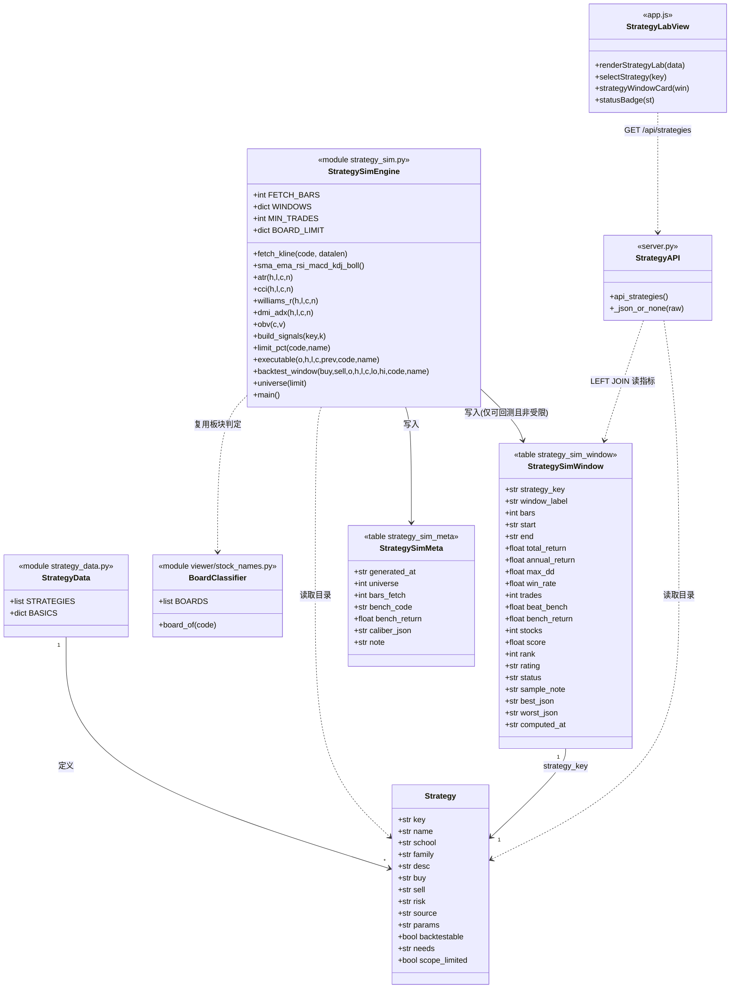
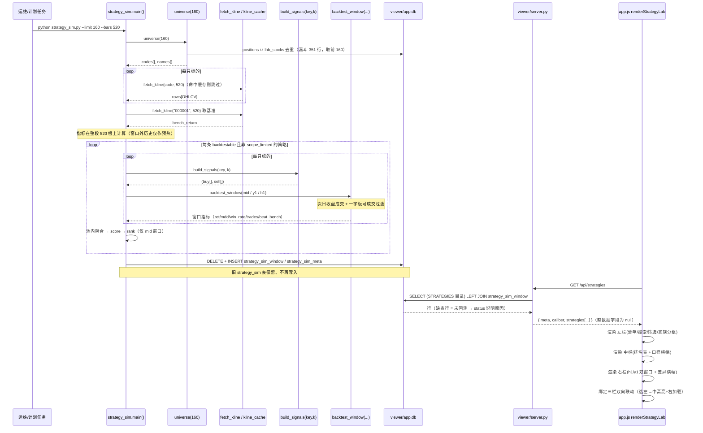
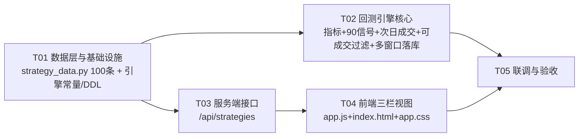

# 策略回测板块 · 技术设计 v1.0

> **归属板块**：本地股票论坛数据查看器 › 「跟我学习」 › 新增横向子板块「**策略回测**」（左-中-右 三栏）
> **文档性质**：系统设计 + 任务分解。**不含实现代码**（本文件是唯一产出）。
> **作者**：架构师 高见远（Bob） ｜ **版本**：v1.0 ｜ **日期**：2026-09-23
> **输入**：`docs/交易策略清单_100条_v1.0.md`（PM 许清楚，v1.0）
> **落盘路径**：`docs/策略回测板块_技术设计_v1.0.md`
> **只读底座（未改动）**：`strategy_data.py`、`strategy_sim.py`、`viewer/server.py`、`viewer/static/app.js`、`viewer/stock_names.py`、`config/kb_sources.yaml`

---

## 0. 阅读须知

### 0.1 本设计的三条铁律

1. **复用现有范式**：`引擎写表 → 接口读表 → 前端渲染`（照搬 `person_score.py` + `person_scores` 表 + `/api/persons` + `renderPersons()` 的做法），**不引框架、不引第三方依赖**（纯标准库 + 单文件前端）。
2. **数据如实**：不可回测 / 口径受限 / 样本不足 三类状态各有独立字段，界面如实展示；**禁止用 0 或估算值顶替**（0 会被读成"收益为 0"，属误导）。
3. **不动旧表、不改老 key**：现有 14 条策略 `key` 一字不改；现有 `strategy_sim` 表保留（**不 DROP**）。

### 0.2 现有代码核实结论（架构师实测，非推测）

以下结论来自对源码的逐行阅读 + 一次**只读** DB 探针（`mode=ro`，未写任何数据）。行号可直接采信。

| 项 | 核实结论 |
|---|---|
| `strategy_sim.py::build_signals` | 170–306 行；单一大 `if/elif` 链，**现仅覆盖 14 个 key**，其余 key 落入末尾 `return buy, sell`（全 False，即"无信号"）。 |
| `strategy_sim.py::backtest` | 310–333 行；**同日成交**（见 §2 决策 2）。 |
| `strategy_sim.py::universe` | 343–363 行；标的池 = `positions ∪ lhb_stocks` 去重，漏斗条件在 **351 行** `s[0] in "03648"`，再 `sorted()` 后取前 `limit` 只。 |
| `strategy_sim.py::main` | 366–507 行；落库 DDL 在 474–497 行（表 `strategy_sim`，**单套指标、无窗口概念**）。 |
| 现有 `strategy_sim` 表 | **存在，14 行**（= 现有 14 条策略）。 |
| `strategy_sim_window` 表 | **不存在**（本次新建）。 |
| **`strategy_sim` 表是否被前端/接口引用** | **没有**。`grep strategy_sim` 在 `viewer/server.py` 与 `viewer/static/app.js` 中**零命中** → 该表目前是**孤儿表**（引擎写、无人读）。结论：删不删都不影响现有页面；**按铁律保留、不再写入**。 |
| `viewer/stock_names.py::board_of` | **已存在**（`BOARDS` 映射 60→沪市主板 / 68→科创板 / 00→深市主板 / 30→创业板 / 43·83·87·92→北交所）。**决策 3 直接复用，不新造。** |
| 标的池实际板块（`limit=160` 实测） | **157 深市主板（00 段）+ 3 创业板（300024 / 300033 / 300046）**。全池 401 只中还含 沪市主板 143 / 科创板 35 / 创业板 64 / 北交所 2，只是被"取最小 160 个代码"截在池外。**池内含 10 只 ST/\*ST**。 |
| 服务端路由风格 | `viewer/server.py::_do_GET`（2848–2987）一串 `if route == "/api/xxx": return self._send_json(api_xxx())`；参数用 `self._int_arg / self._str_arg`；数据用 `DB.conn.execute(...)`；JSON 字段解析用 `_load_json_or_none`。 |
| 前端导航 | 两级：左栏大类 `NAV`（3570–3596）+ 内容区横条子板块。含**关键陷阱**：`itemsOfCat()`（3782–3792）对 `learn` 类在轨道加载后 **`return tracks.concat([{tab:"learn_tracks",...}])`** → 写死在 `NAV.learn.items` 的静态项**会被丢弃**。新增固定子板块必须**同时**改 `NAV.learn.items` 与 `itemsOfCat` 的 learn 分支（见 §2 决策 5）。 |
| 主题色令牌 | `viewer/static/themes/light-tech.css`：`--bg:#FAF7F0`（暖米白）、`--accent:#0E7490`（深青）、`--bull:#C81E1E`（涨=红）、`--bear:#15803D`（跌=绿）、`--warn:#B45309 / --warn-bg:#FEF3C7`、`--info:#38BDF8`、`--c2-fg:#1D4ED8 / --c2-bg:#DBEAFE`。**颜色一律走既有令牌，不新写十六进制。** |
| 布局外壳 | 面板统一为 `<div class="panel" id="p-<tab>">`；`ensurePanel(tab)`（3795–3805）会在缺容器时自动补插到 `.content` → **可零改动 index.html 也能挂上新面板**（但仍建议显式补一行，便于阅读）。 |

---

# Part A · 系统设计

## 1. 实现方案

### 1.1 核心难点

| # | 难点 | 应对 |
|---|---|---|
| 1 | **90 条策略的信号要"从 0 造"**：`build_signals` 现仅 14 个分支，需新增约 76 条，且牵出大批新指标（CCI / 威廉 %R / ATR / DMI-ADX / OBV / 量比 / NR7 / 缺口 / K 线形态 / 连板 / Z-Score / BIAS / 布林带宽 …）。 | 把信号层**分组分批**交付（见 Part B T02 的三个批次）；每个分支只做"映射成 (buy,sell) 两个 bool 序列"这一件事，**不碰回测、不碰落库**，可独立自检。 |
| 2 | **未来函数（同 bar 成交）**：现引擎"当日判定、当日成交"有 1 根 bar 乐观偏差。全量重跑前必须修正口径，否则 90 条的相对强弱都被系统性美化。 | 改 `backtest()` 为**次日收盘成交**（§2 决策 2）。全量重跑 → 内部可比性天然成立。 |
| 3 | **涨停不可成交**：连板/首板类策略的收益是"买不到的收益"。 | 新增**可成交性过滤**（次日一字板 + 近涨停 → 跳过该笔），阈值**按板块**取（§2 决策 3），板块判定**复用 `board_of`**。 |
| 4 | **右栏双窗口**：现引擎只出一套 250 根指标。 | 新增 `strategy_sim_window` 表，**一次抓取切三段**（mid / y1 / h1），基准天然一致（§2 决策 1）。 |
| 5 | **口径受限 4 条**：与"等权满仓"不符。 | 标 `scope_limited=1`，**不产出任何数字、不进排名**（§2 决策 4）。 |
| 6 | **MA250 类策略需要长预热**：250 根不够 `MA250 + 20 日斜率`。 | 抓取长度提到 **`--bars 520`**，指标在整段序列上算，窗口只截统计段（预热段是"历史数据"，**不构成未来函数**）。 |

### 1.2 技术选型（零新依赖）

| 层 | 选型 | 理由 |
|---|---|---|
| 回测引擎 | 扩展现有 `strategy_sim.py`（纯标准库） | 复用 `fetch_kline`（新浪日线，已带 `kline_cache.json` 缓存与 `GAP` 节流）。 |
| 板块判定 | **复用 `viewer/stock_names.py::board_of`** | 已完成 60/68/00/30/43/83/87/92 映射，引入零成本。 |
| 缓存/落库 | SQLite `viewer/app.db`（新增 2 张表） | 与 `person_scores` 同范式：**引擎写、接口秒读**。 |
| 接口 | `viewer/server.py`（`http.server`，纯标准库） | 沿用 `if route == "/api/...": return self._send_json(...)`。 |
| 前端 | `viewer/static/app.js` 单文件 + 现有 CSS 令牌 | 三栏联动是本项目首个此类视图；**不复用 `kb_sources.yaml`**（见决策 5）。 |

### 1.3 架构模式

**沿用现有「离线引擎 + 静态表 + 只读 API + 单页渲染」四段式**（与 `person_score` 完全同构）：

```
strategy_data.STRATEGIES(100 条目录)
        │  读取
        ▼
strategy_sim.py  ── 回测 ──▶  strategy_sim_window / strategy_sim_meta  (SQLite)
        │                              │  只读
        │                              ▼
        │                     viewer/server.py  /api/strategies
        │                              │  JSON
        │                              ▼
        └──────────────────▶  app.js  renderStrategyLab()  三栏联动
```

- **策略目录**（含 family/backtestable/scope_limited）以 `strategy_data.py` 为**唯一真源**；
- **指标数字**以 `strategy_sim_window` 为真源；
- 接口 `LEFT JOIN` 二者：**没有表的行 = 未回测 = 状态字段说明原因**，绝不补 0。

---

## 2. 架构决策定论（逐条回应 PM Open Questions）

### 决策 1 · 右栏双窗口的数据模型 —— **采纳，但升级为"一次抓取切三段"**

- **定论**：新增表 `strategy_sim_window(strategy_key, window_label)`，主键 `(strategy_key, window_label)`。窗口三档：

| `window_label` | 语义 | bars | 用途 |
|---|---|---|---|
| `mid` | 长周期（约 2 年） | 500 | **中栏排名**（跨策略 rank/score/rating 只在这里算） |
| `y1` | 近一年 | 250 | 右栏右列 |
| `h1` | 近半年 | 125 | 右栏左列 |

- **"同一次抓取切两段"还是"两次独立抓取"？→ 同一次抓取切三段，且强烈建议这样。**
  理由：① 只发一次 HTTP（`datalen=520`），新浪只计一次节流；② **三个窗口共用同一份 K 线与同一个基准 `000001`**，因此"近半年 vs 近一年"的比较是同日、同源、可比的——若分两次抓取，两个窗口的起止日与基准可能不同，"双窗口差异提示"就失去意义；③ 切片是纯内存操作，零额外网络成本。
- **实现**：`fetch_kline(code, 520)` 抓一次 → 指标在**整段 520 根**上算 → 每个窗口只把回测区间限定在 `[win_start_idx, end]`（`backtest_window(buy,sell,o,h,l,c,lo,hi)`），信号由**窗口之前的历史 bar 预热**得出（合法，非未来函数）。
- **旧 `strategy_sim` 表**：**保留、不 DROP、不再写入**（实测无任何引用，见 §0.2）。若想省事也可让新引擎顺手**双写** `y1` 结果到旧表以兼容未知的外部脚本——但**界面只读新表**，绝不混用两套口径。
- **MA250 预热注意**：`mid`（500/520）的窗口前预热仅 20 根，`price_above_ma250` / `index_ma250_timing` 在 `mid` 内有效跨度会短于 500 → 由该行的 `bars/trades/sample_note` 如实体现。若要 `mid` 内 MA250 更干净，把 `--bars` 提到 800（成本约 +50%）即可，属可选。

### 决策 2 · 未来函数核实（**最重要**）—— **已核实：确实同 bar 成交，存在 1 根 bar 乐观偏差；采用"次日成交"修正**

**核实过程（读码结论）**：
- `build_signals(key, k)` 生成的 `buy[i] / sell[i]`，其判定用到了 **`close[i]` 及之前**的数据（例：`cross(ma,i)` 用 `i` 与 `i-1`；`c[i] > hh[i-1]` 用当日收盘与历史新高）。→ **信号在 `i` 日收盘确定。**
- `backtest()`（310–333）主循环：**同一轮 `for i`** 内先判 `if buy[i]`，**立即** `pos, cash, entry = cash / c[i], 0.0, c[i]`（319–320 行）—— **用当日收盘价 `c[i]` 成交**；卖出同理（321–322 行）。
- 结论：**`i` 日收盘判定 → `i` 日收盘成交 → 同一根 bar**。模块注释"按当日收盘价成交"（第 8、35 行）属实，也就是说**旧口径本身有 1 根 bar 的乐观偏差**。

**定论**：**采纳"次日成交"修正**（`i` 日收盘成立 → `i+1` 日收盘成交）。理由：本次 100 条**整体重跑**，内部可比性自然成立；用一个可能乐观的旧口径去对齐 90 条策略，不如把口径修正后**如实标注**。

**具体改法**（`strategy_sim.py::backtest`，310–333 行）：引入"挂单"概念，成交发生在**下一根 bar**：

```text
def backtest_window(buy, sell, o, h, l, c, code="", name=""):
    cash, pos, entry = 1.0, 0.0, 0.0
    trades = wins = 0; peak = 1.0; mdd = 0.0; eq_end = 1.0
    pending = 0                       # +1 待买 / -1 待卖
    for i in range(len(c)):
        # ① 先执行上一根 bar 挂下的单（按今日收盘成交）
        if pending == 1 and pos == 0:
            if executable(o[i], h[i], l[i], c[i], c[i-1] if i else c[i], code, name):
                pos, cash, entry = cash / c[i], 0.0, c[i]
                pending = 0
            # 不可成交（一字涨停）→ 撤单，本笔放弃
            else:
                pending = 0
        elif pending == -1 and pos > 0:
            cash, pos = pos * c[i], 0.0
            trades += 1
            if c[i] > entry: wins += 1
            pending = 0
        # ② 再按今日收盘判定信号 → 挂给下一根 bar
        if pos == 0 and buy[i] and pending == 0:
            pending = 1
        elif pos > 0 and sell[i]:
            pending = -1
        # ③ 记净值/回撤
        eq = cash + pos * c[i]; eq_end = eq
        peak = max(peak, eq)
        dd = (eq - peak) / peak if peak > 0 else 0.0
        mdd = min(mdd, dd)
    return {"ret": eq_end - 1.0, "mdd": mdd, "trades": trades, "wins": wins}
```

关键点：**判定在 `i`、成交在 `i+1`**；最后一根 bar 的挂单自然作废（无 `i+1`）。旧的 `backtest(buy, sell, c)` 可保留为内部工具，但对外一律走新函数。

**新旧口径差异说明（写进文档 + 界面口径横幅）**：成交价由 `c[i]` 变为 `c[i+1]`，收益与交易笔数会小幅变化；**旧结果是否还留着** → 旧 `strategy_sim` 表 14 行**保留不动**（无人引用），**界面不读它**；用户看到的一切数字都是新口径。

> ⚠️ **跨团队提醒（给 PM/主理人）**：PM §2.6 要求页脚**原文常驻**"…按**收盘价**成交…"。口径修正为次日成交后，该**原句不再准确**，必须改为："**回测口径：等权单标的满仓、信号次日收盘成交、不计手续费与滑点，用于策略相对强弱比较，不是可实现收益预测。**"（其余不变）。这是对 PM 文案的**必要更正**，请主理人知会 PM。

### 决策 3 · 涨停不可成交 + 可成交性过滤 —— **采纳；阈值按板块，板块判定复用 `board_of`**

- **池内实际板块（实测）**：`limit=160` 时 = **157 深市主板 + 3 创业板**；含 **10 只 ST/\*ST**。全池 401 只另有 沪主板 143 / 科创板 35 / 创业板 64 / 北交所 2（被"最小 160 代码"截在池外）。
- **阈值表**（`limit_pct(code, name)`，复用 `viewer.stock_names.board_of`）：

| 板块（`board_of`） | 涨跌停阈值 |
|---|---|
| 沪市主板 / 深市主板 | 10% |
| 创业板 / 科创板 | 20% |
| 北交所 | 30% |
| **名称含 `ST` / `*ST`（覆盖上述）** | **5%** |

- **双重作用**（不止"可成交"，连"信号判定"也要按板块）：
  1. **信号阈值**：`consecutive_limit_up` / `first_limit_up` 里的 `9.8%` 只是一串魔数；对**创业板**（20% 停板）会把 `+9.8%~+19.9%` 误判成"涨停" → **假信号**。改为 `涨幅 ≥ limit_pct(code,name) * 0.99` 判定（主板/创科/北交/ST 各自正确）。
  2. **可成交性过滤**：信号触发日（`i`）后，**次日（`i+1`）若为一字板** —— `o==h==l==c` 且 `|c[i+1]/c[i]-1| ≥ limit_pct*0.97` —— 视为**买不到/卖不掉，撤单跳过本笔**（`executable()` 返回 False）。
- **诚实声明**：此过滤**只会砍掉虚高的收益**，不会虚增；它是"少算"而非"多算"。过滤掉多少笔，可在 `sample_note` 里如实累计（例："因一字板撤单 12 笔"）。
- **`breadth_timing`（PM Open Q4）定论**：用池内 160 只占比近似全市场宽度，**可接受但必须标注**——在 `strategy_sim_meta.caliber_json` 与该策略的 `risk` 里写明"以 160 只样本池近似市场宽度，非全市场"。不额外建指数成分库。

### 决策 4 · 口径受限的 4 条 —— **确认：标 `scope_limited=1`，不产出数字、不进排名**

| key | 为何与"等权满仓单标的"口径不符 |
|---|---|
| `vol_target_sizing` | 按波动率倒数定仓 → 权重≠100% |
| `kelly_fraction_sizing` | 凯利分仓 → 权重≠100% |
| `dual_momentum` | 需**当日横截面排序** → 需引擎支持截面 |
| `monthly_rebalance` | 月度再平衡 → 组合层，非单标的 |

- **定论**：`scope_limited=true` → 引擎**跳过回测**（不写任何 window 行）→ 接口返回 `status="scope_limited"`、所有数字字段 `null`、`status_note`="该策略的仓位/横截面逻辑与『等权满仓』口径不符，不予回测与排名"。界面在中栏**单列**一个"口径受限·不予排名"卡片，**不显示任何数字**。
- 这样 **90 − 4 = 86 条参与排名**（其中 `not_backtestable` 的 10 条不在这 90 内）。这与"绝不用错误口径给出分数"完全一致。

### 决策 5 · 板块入口怎么挂 —— **走 `NAV.items[].tab`，不走 `kb_sources.yaml`**

- **为什么不用 `kb_sources.yaml`**：该机制（`viewer/kb.py` → `api_kb_doc` → `renderKbDocFor`）是为 **markdown 知识库文档**设计的，产出的是**词条卡/章节**静态正文，**承载不了**"三栏联动 + 表格 + 搜索/多选筛选"。硬塞进去会退化成"把策略清单渲染成一篇文章"，与需求相反。
- **定论**：在 `app.js` 的 `NAV` 里给「跟我学习」新增固定子项 `{ tab: "strategy_lab", label: "策略回测" }`，配独立渲染函数 `renderStrategyLab()`。
- **⚠️ 必改两处（否则会被 `itemsOfCat` 吞掉）**：
  1. `app.js` **3593–3595 行** `NAV[learn].items` 内加一项 `{ tab:"strategy_lab", label:"策略回测" }`（保证**轨道未加载时**也显示）。
  2. `app.js` **3788 行** learn 分支改为：
     ```js
     return tracks.length
       ? tracks.concat([{ tab:"strategy_lab", label:"策略回测" },
                        { tab:"learn_tracks", label:"学习轨道管理" }])
       : cat.items;
     ```
     （保证**轨道加载后**固定项仍在——这是本设计**最易踩的坑**，务必写进验收。）
- **路由放行**：`strategy_lab` 不以 `learn_` 开头 → `selectNav` 的 `docKeyOfTab`/`relaxed` 逻辑**天然不会误路由**，无需额外改动。
- **面板**：`ensurePanel("strategy_lab")` 会自动建 `#p-strategy_lab`；同时在 `index.html`（78 行附近）显式补 `<div class="panel" id="p-strategy_lab"></div>` 便于阅读。
- **派发**：`selectNav` 的 `if (tab === "xxx")` 链（3693–3710 一带）加一支 `if (tab === "strategy_lab") { ... renderStrategyLab() }`。

### 决策 6 · 接口契约 —— **一个全量接口 `/api/strategies` 足够；不设独立 detail 接口**

- **定论**：`GET /api/strategies` **一次返回全部 100 条 + 各窗口指标**（约 100 × ~1.5KB ≈ 150KB，量极小），前端**本地**做搜索/流派多选/家族分组/三栏联动——与 `/api/persons` "一次全量、前端排序"的既有范式一致。**不需要** `/api/strategy_detail`。
- **可选**：保留 `?school=&family=&q=` 服务端预筛（本期可不实现，前端筛已足够）；若未来数据涨大再加。
- **三种状态在 JSON 里的表达**（**关键：不可回测绝不用 0 冒充**）：

| 状态 | `status` | 数字字段 | 说明 |
|---|---|---|---|
| 可回测 | `"ok"` | 有值 | — |
| 不可回测（10 条） | `"not_backtestable"` | **全 `null`** | `needs` 给出缺什么数据 |
| 口径受限（4 条） | `"scope_limited"` | **全 `null`** | `status_note` 说明口径不符 |
| 样本不足（窗口级） | `"insufficient"` | 有值 + `sample_note` | `trades < MIN_TRADES(30)`，界面打"样本不足" |

> 注：`not_backtestable` 与 `scope_limited` 在所有窗口对象的字段上统一为 `null`；`insufficient` 是**窗口级**状态（`mid` 或某窗口交易次数过少），策略级 `status` 仍可为 `ok`。

**完整 JSON Schema（字段名/类型/示例值，与前段渲染字段一一对应）**：

```jsonc
// GET /api/strategies
{
  "generated_at": "2026-09-23 10:20:00",        // string
  "caliber": {                                   // 口径横幅（常驻、不可关）
    "title": "回测口径",
    "text": "等权单标的满仓、信号次日收盘成交、不计手续费与滑点；用于策略相对强弱比较，不是可实现收益预测。",
    "fill": "next_close",                        // 成交口径：次日收盘
    "limit_up_filter": true,                     // 已启用可成交性过滤
    "bench": { "code": "000001", "name": "上证指数" },
    "bars_fetch": 520
  },
  "meta": {
    "total": 100, "backtestable": 90, "not_backtestable": 10,
    "scope_limited": 4, "ranked": 86,            // 实际参与排名条数
    "min_trades": 30,
    "windows": [
      { "label": "mid", "name": "长周期(约2年)", "bars": 500 },
      { "label": "y1",  "name": "近一年",       "bars": 250 },
      { "label": "h1",  "name": "近半年",       "bars": 125 }
    ],
    "schools": ["趋势跟踪","均值回归","突破","量价","摆动指标","形态","波动率与风控","动量与相对强弱","组合/仓位/择时"],
    "board_note": "标的池含沪深主板/创业板/科创板/北交所；涨跌停阈值按板块（主板10%/创科20%/北交30%/ST5%）。"
  },
  "strategies": [
    {
      "key": "ma_cross_20_60",
      "name": "双均线趋势跟踪（MA20 × MA60）",
      "school": "趋势跟踪",
      "family": "dual_ma",
      "desc": "用中期均线与长期均线的交叉判断趋势方向……",
      "buy": "MA20 上穿 MA60",
      "sell": "MA20 下穿 MA60",
      "risk": "震荡市里反复被打脸（假突破多）……",
      "source": "均线理论（经典趋势跟随框架）",
      "params": "fast=20, slow=60",
      "backtestable": true,
      "needs": null,                 // 不可回测时为字符串，如 "资金流 / Level-2 逐笔成交数据"
      "scope_limited": false,
      "status": "ok",                // ok | not_backtestable | scope_limited
      "status_note": null,           // 不可回测/受限时给中文原因
      "mid": {                       // 中栏（长周期排名）—— 无数据时为 null
        "window_label": "mid", "bars": 500,
        "start": "2024-10-08", "end": "2026-09-22",
        "rank": 3,                   // int
        "total_return": 12.34,       // %（方向色：正=红/负=绿）
        "annual_return": 8.10,
        "max_dd": -20.50,            // %（越大越不利=越绿 + ⚠）
        "win_rate": 55.2,            // %
        "trades": 120,               // int（<30 → 样本不足）
        "beat_bench": 60.0,          // %（池内跑赢 000001 的标的占比）
        "stocks": 160,
        "bench_return": -3.20,       // %（基准同期）
        "score": 10.50,
        "rating": "良好",            // 优秀/良好/一般/较差
        "status": "ok",              // ok | insufficient | no_data
        "sample_note": null,         // 例 "交易 12 笔，样本不足；一字板撤单 5 笔"
        "best":  { "code": "300750", "name": "宁德时代", "ret": 0.51 },
        "worst": { "code": "000002", "name": "万科A",   "ret": -0.42 }
      },
      "windows": [                   // 右栏 双窗口（顺序：h1, y1）—— 无数据时为 null
        { "window_label": "h1", "name": "近半年", "bars": 125,
          "start": "2026-03-24", "end": "2026-09-22",
          "total_return": 4.10, "bench_return": 1.20, "excess": 2.90,
          "max_dd": -8.30, "win_rate": 52.0, "trades": 33, "stocks": 160,
          "status": "ok", "sample_note": null },
        { "window_label": "y1", "name": "近一年", "bars": 250,
          "start": "2025-09-08", "end": "2026-09-22",
          "total_return": 6.90, "bench_return": -3.20, "excess": 10.10,
          "max_dd": -14.10, "win_rate": 54.0, "trades": 61, "stocks": 160,
          "status": "ok", "sample_note": null }
      ]
    },
    {
      "key": "main_fund_inflow", "name": "主力资金连续净流入", "school": "资金面",
      "family": "fund_flow", "desc": "……", "buy": "……", "sell": "……", "risk": "……",
      "source": "资金流向指标（公开通用概念）", "params": "days=3",
      "backtestable": false, "needs": "资金流 / Level-2 逐笔成交数据",
      "scope_limited": false, "status": "not_backtestable",
      "status_note": "缺少资金流/Level-2 数据，本次不可回测",
      "mid": null, "windows": null
    },
    {
      "key": "vol_target_sizing", "name": "波动率目标仓位", "school": "波动率与风控",
      "family": "vol_target", "desc": "……", "buy": "……", "sell": "……", "risk": "……",
      "source": "波动率目标（公开通用量化规则）", "params": "target=20%, cap=100%",
      "backtestable": true, "needs": null,
      "scope_limited": true, "status": "scope_limited",
      "status_note": "按波动率倒数定仓，与『等权满仓』口径不符，不予排名",
      "mid": null, "windows": null
    }
  ]
}
```

### 决策 7 · 任务分解 —— 见 Part B（5 个任务，有序、含依赖与验收）

---

## 3. 文件清单

| 类型 | 绝对路径 | 作用 |
|---|---|---|
| **新增** | `F:\AI Agent部署知识库\2026-09-22-11-49-42\stock-forum-scraper\docs\策略回测板块_技术设计_v1.0.md` | 本设计文档。 |
| **修改** | `…\stock-forum-scraper\strategy_data.py` | `STRATEGIES` 由 14 → 100 条；每条补 `family / params / backtestable / needs / scope_limited`。**旧 14 key 不动。** |
| **修改** | `…\stock-forum-scraper\strategy_sim.py` | ① 顶部常量 `FETCH_BARS/WINDOWS/BOARD_LIMIT`；② 新增指标函数；③ `build_signals` 扩到 90 条；④ `backtest_window()`（次日成交 + 可成交过滤）；⑤ `limit_pct()/executable()`；⑥ `universe()` 补板块识别；⑦ `main()` 多窗口切片 + 新表落库。 |
| **修改** | `…\stock-forum-scraper\viewer\server.py` | 新增 `api_strategies()`；在 `_do_GET`（2866 行一带）注册 `/api/strategies`。 |
| **修改** | `…\stock-forum-scraper\viewer\static\app.js` | 新增 `renderStrategyLab()` 等；改 `NAV[learn].items`（3593）、`itemsOfCat` learn 分支（3788）、`selectNav` 派发链。 |
| **修改** | `…\stock-forum-scraper\viewer\static\index.html` | 78 行附近补 `<div class="panel" id="p-strategy_lab"></div>`。 |
| **修改** | `…\stock-forum-scraper\viewer\static\app.css` | 新增三栏布局/联动/状态徽标样式（复用现有令牌，`--bull/--bear/--warn/--info/--accent`）。 |
| **新增（DB）** | `viewer\app.db` → 表 `strategy_sim_window`、`strategy_sim_meta` | 引擎自动 `CREATE TABLE IF NOT EXISTS`，无需手工建库脚本。 |
| **不动** | `config\kb_sources.yaml`、`viewer\kb.py`、`viewer\person_score.py`、`strategy_sim` 旧表 | 只读/不改。 |

---

## 4. 数据结构与接口（类图）



---

## 5. 程序调用流程（时序图）



---

## 6. 待明确事项（Anything UNCLEAR / 假设）

1. **口径横幅文案必须更新**（见决策 2 末）：PM 原文"按收盘价成交"在次日成交修正后不再准确，请主理人知会 PM 统一改字。
2. **`mid`=500 的 MA250 预热**：若验收时希望 `price_above_ma250` 在 `mid` 内也有满额 500 根样本，把 `--bars` 提到 800；默认 520。**权当假设，由主理人拍板。**
3. **`best/worst` 是否展示**：JSON 已含 `best/worst`（单标的极值）。PM §2.3 未列该列，默认**中栏不展示**、仅 hover/详情用；如需展示请告知。
4. **"跑赢基准比例"定义沿用**：`beat_bench` = 池内 `ret > bench` 的标的占比（沿用现引擎口径），非"策略整体是否跑赢"，界面 tooltip 需写明。
5. **`ranked=86` 的口径**：中栏排名**只排 86 条**（可回测 90 − 口径受限 4）；不可回测 10 条单独占位。若主理人希望中栏也列出 100 条的"占位行"，前端可加"显示不可回测"开关（默认关）。
6. **ST 判定依赖股票名**：`limit_pct` 的 ST 覆盖需要 `stock_names` 里的名称；名称缺失的 ST 股会退化为按板块阈值。实测池内 10 只 ST 均有名称，风险低。
7. **未跑真实回测**：本设计基于源码与只读探针；90 条策略的**实际数字**需实现阶段跑 `--limit 160 --bars 520` 后回填。

---

# Part B · 任务分解

## 7. 依赖包（Required Packages）

**新增第三方依赖：无。** 全程纯 Python 标准库（`sqlite3 / urllib / json / ssl / argparse / datetime`）+ 单文件前端（原生 JS）。

```
- （无）  本项目坚持「纯标准库 + 单文件前端」，本板块同样不引入任何新依赖。
- 复用现有：viewer/stock_names.py::board_of（板块判定）
- 复用现有：strategy_sim.fetch_kline / kline_cache.json（行情 + 缓存）
```

> 运行解释器：`"F:\AI Agent部署知识库\2026-09-22-11-49-42\stock-forum-scraper\.venv\Scripts\python.exe"`

## 8. 任务列表（≤5，按依赖排序）

> 说明：本仓库核心仅 5 个源文件，硬约束"每任务 ≥3 文件"在此**不成立**；按**分层**分组（架构师判断），并明确给出每步改动的**函数/行号区间**与**验收标准**。T02 的信号分支按 PM 要求拆为**3 个内部批次（B1/B2/B3）交付**。

### T01 · 数据层与基础设施 — 策略目录扩至 100 条 + 引擎常量/建表 DDL
- **文件**：`strategy_data.py`、`strategy_sim.py`
- **改动**：
  - `strategy_data.py`：`STRATEGIES`（195 行起）扩为 **100 条**（14 旧 + 86 新，旧 key 一字不改），每条补 `family / params / backtestable / needs / scope_limited`（数据直接取自 PM 文档附录 A 与正文；`backtestable=false` 恰 10 条 #91–#100；`scope_limited=true` 恰 4 条：`vol_target_sizing / kelly_fraction_sizing / dual_momentum / monthly_rebalance`）。
  - `strategy_sim.py`：顶部新增常量 `FETCH_BARS=520`、`WINDOWS={"mid":500,"y1":250,"h1":125}`、`BOARD_LIMIT={"沪市主板":0.10,"深市主板":0.10,"创业板":0.20,"科创板":0.20,"北交所":0.30}`、`ST_LIMIT=0.05`；新增 `ensure_tables(con)`（`CREATE TABLE IF NOT EXISTS strategy_sim_window / strategy_sim_meta`）；`from viewer.stock_names import board_of`。
- **依赖**：无
- **优先级**：P0 ｜ **不可并行**（其余全部依赖它）
- **验收**：`python -c "import strategy_data; print(len(STRATEGIES))"` = `100`；`len({s['key'] for s in STRATEGIES})` = `100`；旧 14 个 key 集合不变；`sum(not s.get('backtestable',True) for s in STRATEGIES)` = `10`；`sum(s.get('scope_limited') for s in STRATEGIES)` = `4`；`ensure_tables` 后两表存在。

### T02 · 回测引擎核心 — 指标 + 90 条信号 + 次日成交 + 可成交过滤 + 多窗口落库
- **文件**：`strategy_sim.py`
- **改动**：
  - 新增指标函数：`atr / cci / williams_r / dmi_adx / obv / vol_ratio / nr7 / zscore / bias / boll_width / pattern(锤子/吞没/晨星/红三兵/W底/头肩底/箱体/楔形/缺口/连板)`。
  - `build_signals`（170–306）**扩到 90 条分支**，按 **3 个内部批次**交付：
    - **B1（35 条）**：趋势跟踪 13 + 均值回归 11 + 突破 11 → 跑 `--limit 20 --bars 520` 抽查每分支信号**非全 False**。
    - **B2（35 条）**：量价 11 + 摆动指标 13 + 形态 11（含 `consecutive_limit_up/first_limit_up` 用 `limit_pct` 判板）→ 同上抽查。
    - **B3（20 条）**：波动率与风控 9（其中 2 条 `scope_limited` 直接返回空）+ 动量与相对强弱 6（含 `dual_momentum` 受限返回空）+ 组合/仓位/择时 5（含 `monthly_rebalance` 受限返回空）→ 抽查。
  - 新增 `limit_pct(code,name)`（复用 `board_of` + ST 覆盖）、`executable(o,h,l,c,prev,code,name)`（一字板过滤）。
  - 新增 `backtest_window(...)`（**次日收盘成交**，310 行 `backtest` 的逻辑重写为"挂单"模型；旧 `backtest` 保留备用）。
  - `universe()`（343–363）：保留原池，返回时附每只标的的 `board` 与 `name`（供 `limit_pct` 用）。
  - `main()`（366–507）：抓 `FETCH_BARS` → 对每条 `backtestable and not scope_limited` 的策略，对 `mid/y1/h1` 三窗口分别 `backtest_window` 并聚合 → 仅 `mid` 窗口算 `score/rank/rating` → `DELETE + INSERT strategy_sim_window / strategy_sim_meta`；**不写** `strategy_sim` 旧表。
- **依赖**：T01
- **优先级**：P0 ｜ 与 T03 **可并行**（不同文件）
- **验收**：每批次跑 `--limit 20 --bars 520` **无异常**；全量 `--limit 160 --bars 520` 产出三窗口且无 `NaN/None` 混入数字列；`strategy_sim_window` 行数 = `86 × 3 = 258`；一字板撤单笔数在 `sample_note` 可见；对已知同 bar 偏差抽 1 条策略手算验证"次日成交"生效（成交价 = 信号次日收盘）。

### T03 · 服务端接口 — `/api/strategies`
- **文件**：`viewer/server.py`
- **改动**：新增 `api_strategies()`（放在 `api_persons` 727 行附近）；在 `_do_GET`（**2866–2867 行** `/api/persons` 之后）插入路由 `if route == "/api/strategies": return self._send_json(api_strategies())`；实现"`STRATEGIES`（`sys.path` 导入 `strategy_data`）`LEFT JOIN strategy_sim_window`"组装 §2 决策 6 的 JSON；`not_backtestable/scope_limited/no_data` → 数字字段 `null`；复用 `_load_json_or_none` 解析 `best/worst`。
- **依赖**：T01（读表结构）；**接口对表缺失必须优雅降级**（表不存在 → 返回目录 + 全 `null`，绝不 500）。
- **优先级**：P0 ｜ 与 T02 **可并行**
- **验收**：`curl` / 浏览器访问 `http://127.0.0.1:8765/api/strategies`（`NO_PROXY=127.0.0.1,localhost`）返回 100 条；`not_backtestable` 条 `mid==null && needs!=null`；`scope_limited` 条 `status=="scope_limited" && mid==null`；无 `0` 冒充缺失。

### T04 · 前端三栏视图 + 导航挂载
- **文件**：`viewer/static/app.js`、`viewer/static/index.html`、`viewer/static/app.css`
- **改动**：
  - `app.js`：`NAV[learn].items`（**3593–3595**）加 `{tab:"strategy_lab",label:"策略回测"}`；`itemsOfCat` learn 分支（**3788**）改为 `tracks.concat([{tab:"strategy_lab",...},{tab:"learn_tracks",...}])`；`selectNav` 派发链加 `if (tab === "strategy_lab") { ... renderStrategyLab() }`；新增 `renderStrategyLab(data)`（左=清单/搜索/9 流派多选/家族分组/仅看可回测开关；中=排名表 + 常驻口径横幅；右=h1/y1 双窗口 + 差异横幅 + 空状态卡）、`selectStrategy(key)`、`statusBadge(st)`。
  - `index.html`（78 行附近）：补 `<div class="panel" id="p-strategy_lab"></div>`。
  - `app.css`：三栏布局（可拖拽、`<1100px` 折叠）、状态徽标、红绿/警示/提示配色——**全部复用现有令牌**（`--bull/--bear/--warn/--warn-bg/--info/--accent/--c2-*`），不新写色值。
- **依赖**：T03（接口契约）
- **优先级**：P0 ｜ 不可并行（依赖 T03 的字段名）
- **验收**：从「跟我学习」横条点「策略回测」进入；**刷新后该项仍在**（验证 3788 行改动生效）；三栏双向联动正常；不可回测策略中/右两栏显示"缺数据"虚线卡且**无 0**；涨=红跌=绿符合 A 股习惯；口径横幅常驻可见。

### T05 · 联调与验收
- **文件**：无代码改动（验收清单/脚本，可放 `docs/`）
- **改动**：跑通完整链路，核对数据如实性。
- **依赖**：T02 + T04
- **优先级**：P0 ｜ 串行收尾
- **验收**：`strategy_sim_window` 落库 → 重启后前端展示一致；抽查 3 条（1 趋势 / 1 连板 / 1 受限）三栏数字与库一致；确认"不可回测/口径受限/样本不足"三种状态在界面**均有独立可见表述且不含 0**；口径横幅文案为**次日成交**版。

## 9. 共享知识（Shared Knowledge）

- **JSON 响应**：本项目 API 不做 `{code,data,message}` 包装，直接返回业务对象/数组（与 `/api/persons` 一致）；错误回 `{"error": "..."}` + 非 200。
- **缺失即 `null`**：不可回测 / 口径受限 / 无数据 一律 `null` + `status` 字段；**禁止 0 顶替**。
- **策略目录真源**：`strategy_data.STRATEGIES`；指标真源：`strategy_sim_window`；二者由接口 LEFT JOIN。
- **成交口径**：**信号当日收盘判定 → 次日收盘成交**；不计手续费与滑点；等权单标的满仓。
- **板块与涨跌停**：用 `board_of`（沪主板/深主板 10%、创业板/科创板 20%、北交所 30%）+ ST 名 5%；可成交性过滤以上一天收盘为基准。
- **颜色（A 股习惯）**：涨=`--bull(#C81E1E 红)`、跌=`--bear(#15803D 绿)`、零/中性=`--muted`；风险类越大越不利=越绿 + ⚠；警示横幅用 `--warn`（黄）、提示横幅用 `--info/--c2`（蓝）——**横幅不用红绿**，避免与涨跌混淆。
- **主题**：浅色暖米白 `--bg:#FAF7F0`，突出色深青 `--accent:#0E7490`。
- **文案**：全中文，**不得出现公司名称等品牌信息**；不出现"推荐/必赚/年化可达 X%"。
- **导航陷阱**：新增「跟我学习」固定子板块必须**同时**改 `NAV.learn.items` 与 `itemsOfCat` learn 分支，否则轨道加载后被吞。
- **解释器**：`.venv\Scripts\python.exe`；服务在 `127.0.0.1:8765`（**勿重启**）；访问 localhost 需 `NO_PROXY=127.0.0.1,localhost`。

## 10. 任务依赖图（Task Dependency Graph）



---

## 11. 最大风险点与规避办法

| 风险 | 等级 | 规避 |
|---|---|---|
| **未来函数修正引入新偏差**（挂单模型写错，出现"用当天收盘价成交"回归或双成交） | 高 | T02 交付时**必须**用 1 条已知策略手算对拍：成交价 = 信号次日收盘；并断言最后一日挂单作废。 |
| **一字板过滤把可用样本砍太多**，导致连板类策略"样本不足"暴增 | 中 | 过滤条件收紧为"`o==h==l==c` 且近涨停"，**仅砍一字板**；其余（如开盘价可成交的换手板）保留；`sample_note` 如实累计撤单笔数。 |
| **`itemsOfCat` 吞掉新子板块**（最隐蔽） | 中 | T04 验收专门包含"刷新后仍可见"；改 3788 行 + `NAV` 双处。 |
| **`scope_limited` 被误算出"劣质分数"** | 中 | 引擎层直接 `continue` 跳过（不写 window 行），接口层兜底置 `null`；界面单列卡片。 |
| **90 条信号工作量大、易出静默错误**（分支写了但信号全 False，看着"没报错"） | 高 | 按 B1/B2/B3 分批，每批**逐分支抽查"信号非全 False"**；落库后核对 `258` 行 & 无 `NaN`；交易次数分布落在合理区间（不做 0 交易）。 |
| **接口与前端字段名漂移** | 中 | §2 决策 6 的 JSON Schema 即契约；T03 完成后 T04 才开工；两端共用同一字段名清单。 |
| **口径横幅文案未同步**（仍写"按收盘价成交"） | 低 | 列入 T05 验收项 + 已在本文件顶部标注为**跨团队更正**。 |

---

## 12. 附录 · 新增表 DDL（供 T01/T02 直接采用）

```sql
-- 窗口级指标（主键 = 策略 × 窗口）
CREATE TABLE IF NOT EXISTS strategy_sim_window (
  strategy_key  TEXT NOT NULL,
  window_label  TEXT NOT NULL,          -- 'mid' | 'y1' | 'h1'
  bars          INTEGER,                -- 该窗口实际根数
  start         TEXT,                   -- YYYY-MM-DD
  end           TEXT,
  total_return  REAL,                   -- 池内等权平均总收益 %
  annual_return REAL,
  max_dd        REAL,                   -- 池内平均最大回撤 %
  win_rate      REAL,                   -- 全池胜率 %
  trades        INTEGER,                -- 全池交易笔数
  beat_bench    REAL,                   -- 跑赢基准标的占比 %
  bench_return  REAL,                   -- 基准(000001)同期 %
  stocks        INTEGER,                -- 覆盖标的数
  score         REAL,                   -- 仅 mid 计算；其余 NULL
  rank          INTEGER,                -- 仅 mid
  rating        TEXT,                   -- 仅 mid（优秀/良好/一般/较差）
  status        TEXT,                   -- 'ok' | 'insufficient' | 'no_data'
  sample_note   TEXT,                   -- 样本不足 / 一字板撤单 N 笔 等
  best_json     TEXT,
  worst_json    TEXT,
  computed_at   TEXT,
  PRIMARY KEY (strategy_key, window_label)
);

-- 单行元信息（组合全局参数与口径）
CREATE TABLE IF NOT EXISTS strategy_sim_meta (
  id          INTEGER PRIMARY KEY CHECK (id = 1),
  generated_at TEXT,
  universe    INTEGER,
  bars_fetch  INTEGER,
  bench_code  TEXT,
  bench_return REAL,
  start       TEXT,
  end         TEXT,
  caliber_json TEXT,                    -- 口径横幅全文 + fill/limit_up_filter 标记
  note        TEXT
);
```

> **旧 `strategy_sim` 表**：结构不动、数据保留（14 行）、新引擎不再写入。已核实无引用，无需迁移。
